# GT Trackball — a wireless 3" arcade trackball for Golden Tee

A 3D-printed arcade trackball controller with **Bluetooth and wired USB**,
a **battery**, three lit buttons and an **e-paper screen** that shows
connection, battery and a **swing meter** for every shot. Built for
Golden Tee Live under TeknoParrot, but it is a standard mouse, so it works
with any game, emulator or computer.

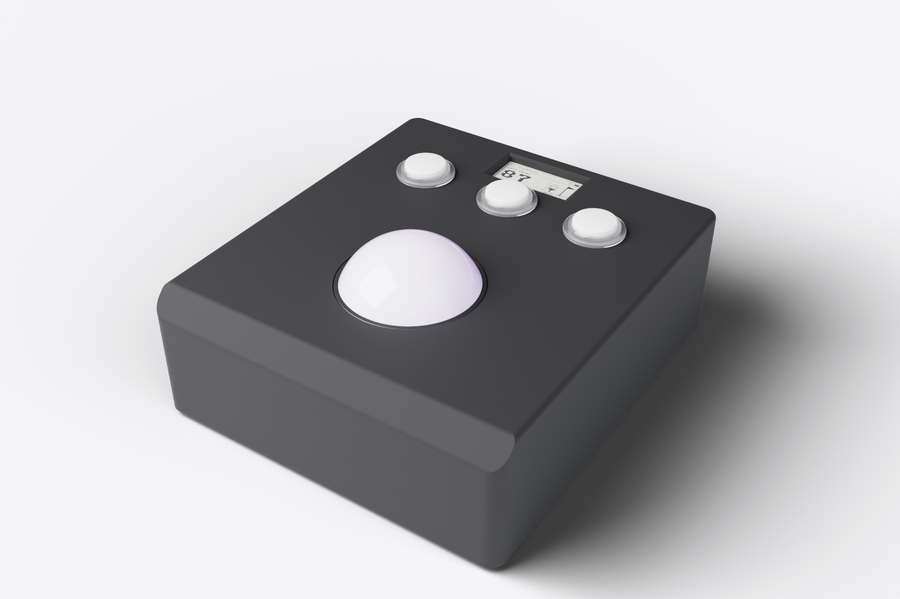

| | |
|---|---|
| 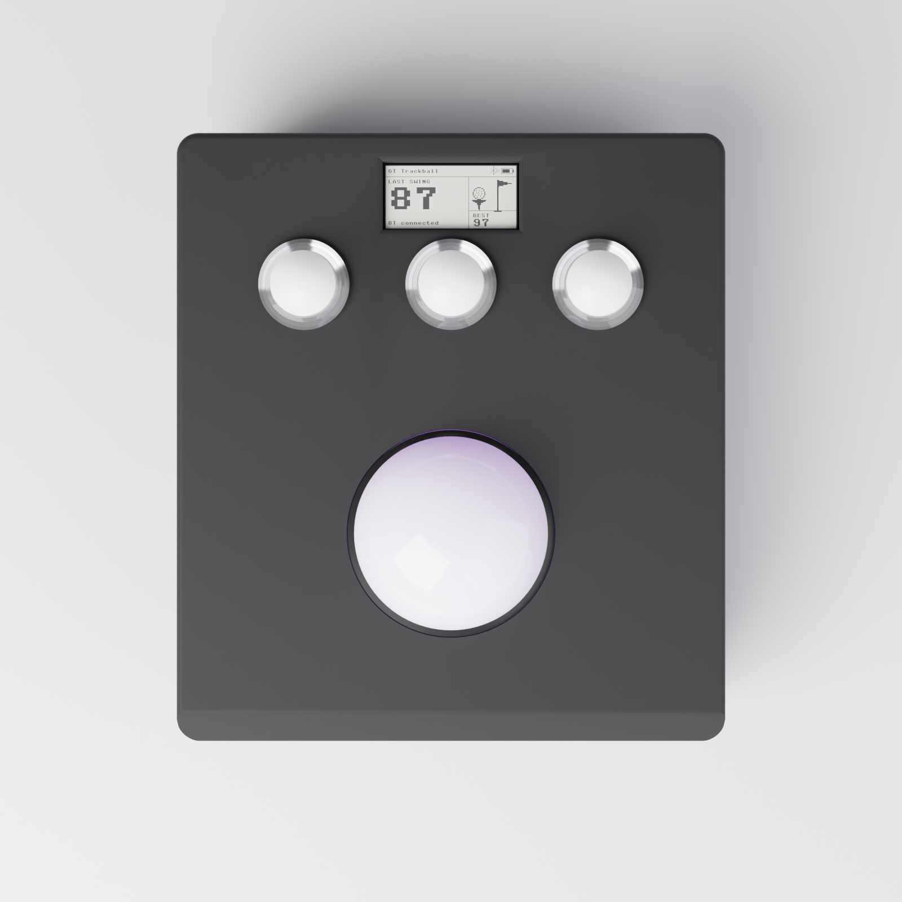 | 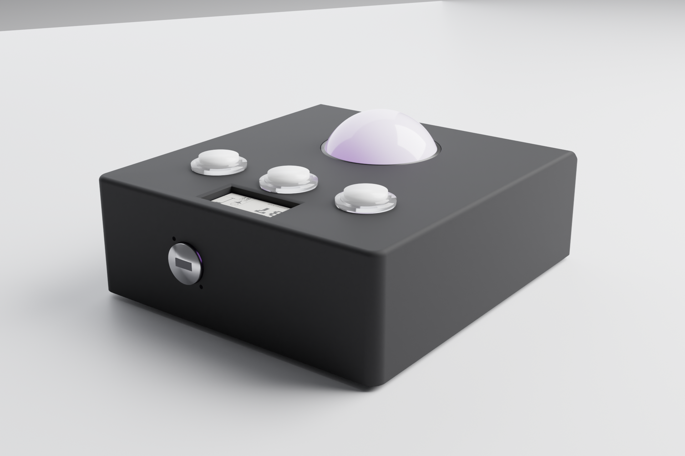 |

- **Bluetooth LE mouse** on battery; **USB mouse** (and charging) when the
  cable is plugged in — one USB-A port on the back does both
- **3" illuminated arcade trackball** held on the same proven pins as the
  original case it is based on
- **E-paper status screen**: Bluetooth / USB, battery, last swing and best
  swing, pixel-art animations — and the picture stays on at zero power
- **No power switch**: sleeps after 5 minutes, wakes on a button press
- **Prints without supports** on a 256 mm bed; one ready-made Bambu Studio
  project with all settings
- Works on Windows and macOS; optional scripts for TeknoParrot + RetroBat

> Remix of [3-Inch Arcade Trackball Case](https://www.thingiverse.com/thing:7334881)
> by vkschannel (CC BY-SA). See [Credits & licence](#credits--licence).

---

## Contents

1. [How it works](#how-it-works)
2. [Parts list](#parts-list)
3. [Step 1 — Print the case](#step-1--print-the-case)
4. [Step 2 — Prepare the electronics](#step-2--prepare-the-electronics)
5. [Step 3 — Wire it up](#step-3--wire-it-up)
6. [Step 4 — Bench test](#step-4--bench-test)
7. [Step 5 — Assemble](#step-5--assemble)
8. [Step 6 — Pair and play](#step-6--pair-and-play)
9. [Golden Tee, TeknoParrot and RetroBat](#golden-tee-teknoparrot-and-retrobat)
10. [Customising](#customising)
11. [Troubleshooting](#troubleshooting)
12. [Build it with Claude Code (optional)](#build-it-with-claude-code-optional)
13. [Repository layout](#repository-layout)
14. [Credits & licence](#credits--licence)

---

## How it works

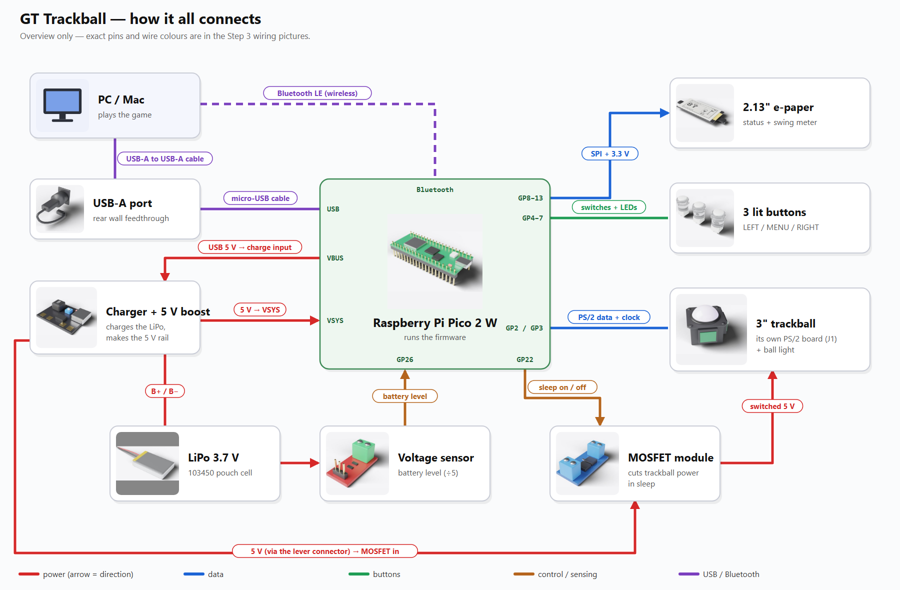

A **Raspberry Pi Pico 2 W** is the brain. It talks to the trackball's own
little interface board over **PS/2** (2 wires), reads the three buttons,
drives the e-paper screen, and shows up on your computer as a mouse —
over **Bluetooth**, or over **USB** when the cable is in.

Power comes from a small **LiPo pouch** through a **charger + 5 V boost
board**. The USB port on the back feeds the Pico, and the Pico's VBUS pin
feeds the charger, so the same cable charges the battery while you play.
A **MOSFET module** cuts power to the trackball when the controller
sleeps, and a **voltage sensor** lets the Pico read the battery level.

---

## Parts list

### Electronics

The links are examples that match the dimensions the case is designed for
(no affiliate links). Equivalent parts from any seller work; check the sizes in the Notes column.

| | # | Part | Qty | Notes | Buy |
|---|---|---|---|---|---|
| 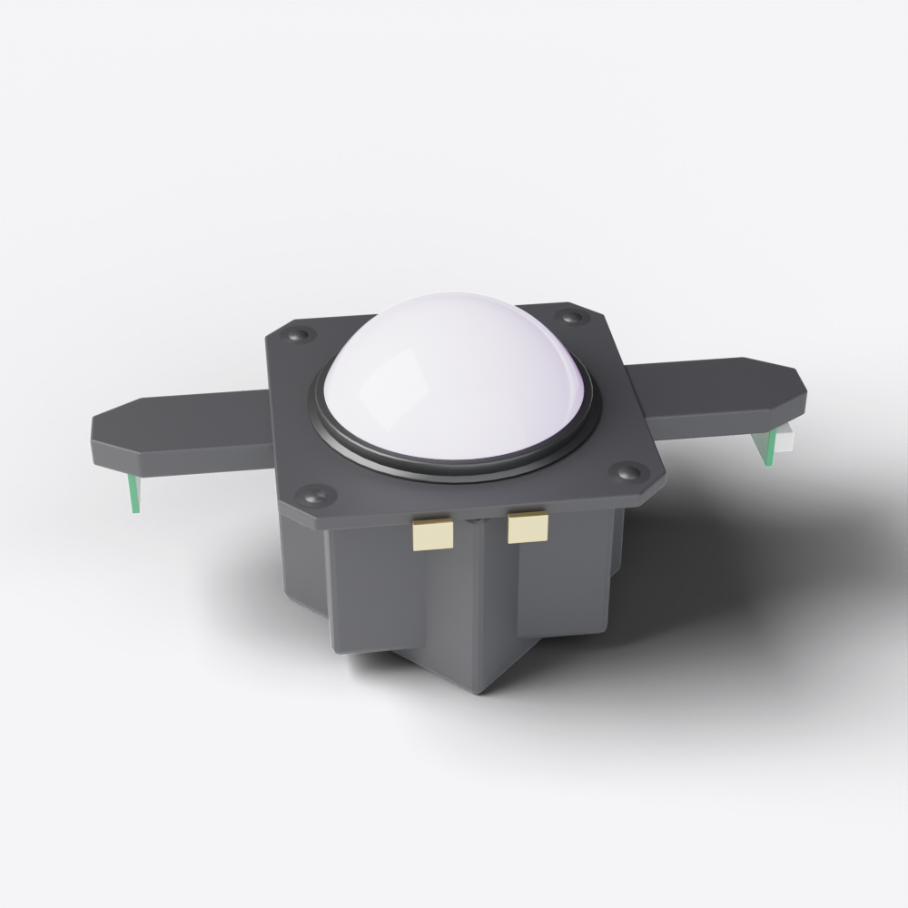 | 1 | **3" illuminated arcade trackball, USB/PS2** (generic, e.g. AliExpress "3 inch trackball LED USB") | 1 | Ball Ø76.2, mounting holes on an 80.5 mm square. Its own interface board stays: connector **J1** = +5V, DATA, CLOCK, GND, M, R, L | [AliExpress](https://www.aliexpress.com/item/1005005806654620.html) |
| 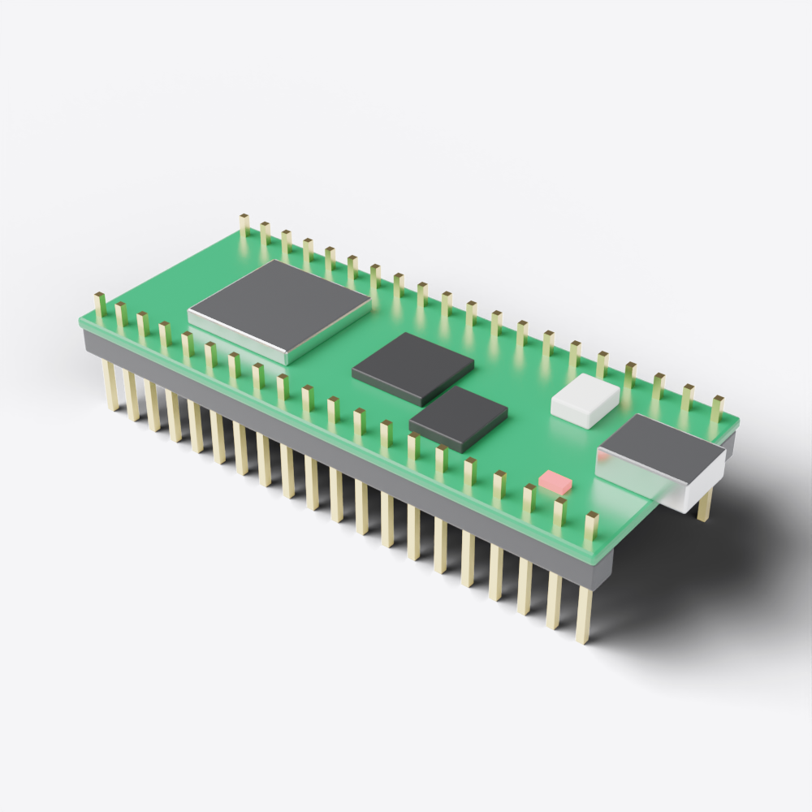 | 2 | **Raspberry Pi Pico 2 W** (RP2350, with wireless) | 1 | Must be the **2 W**: the RP2350's 5 V-tolerant pins and Bluetooth are both needed. Headers soldered on (pins point up in the case) | [Amazon](https://www.amazon.com/dp/B0DQ7NHGH8) (Waveshare, headers on) |
| 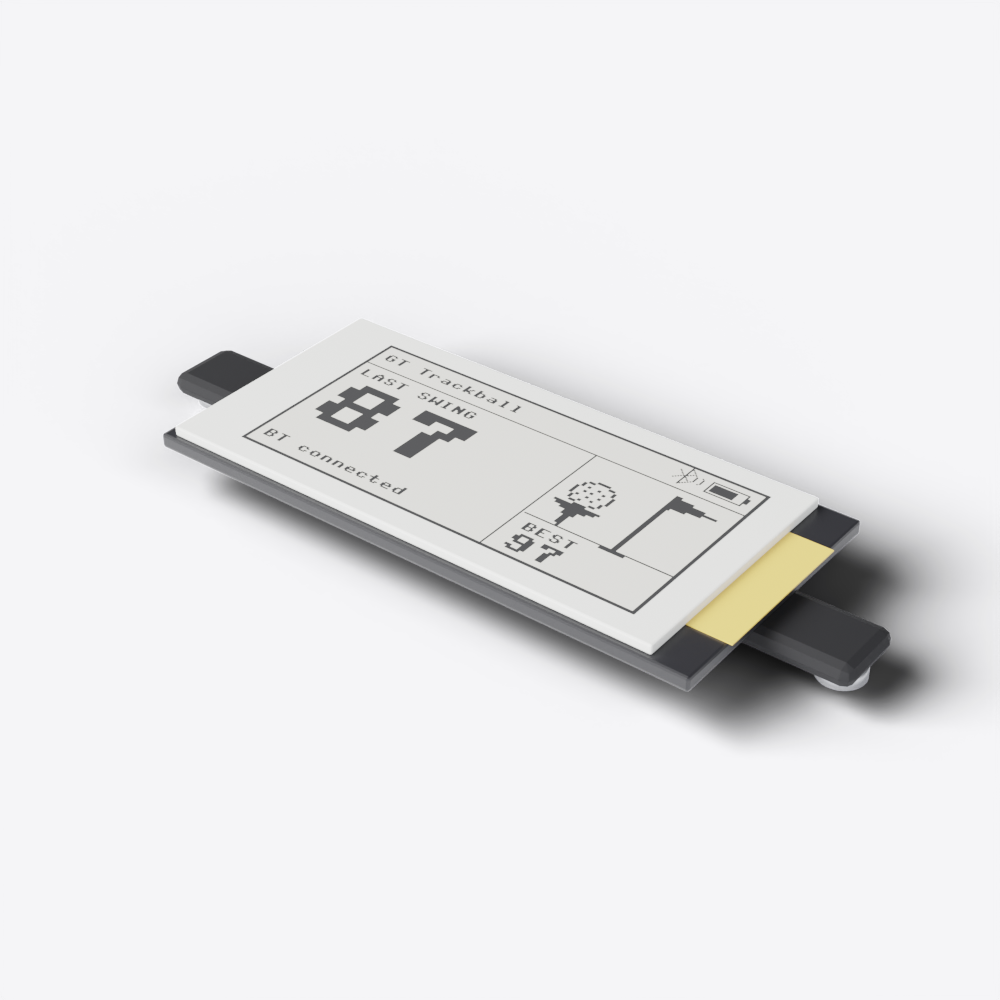 | 3 | **Waveshare 2.13" e-Paper HAT V4** (250 × 122, Raspberry Pi format, 65 × 30.5 mm) | 1 | Wired with its 8-pin JST lead — it does not plug onto the Pico | [Amazon](https://www.amazon.com/dp/B071S8HT76) |
| 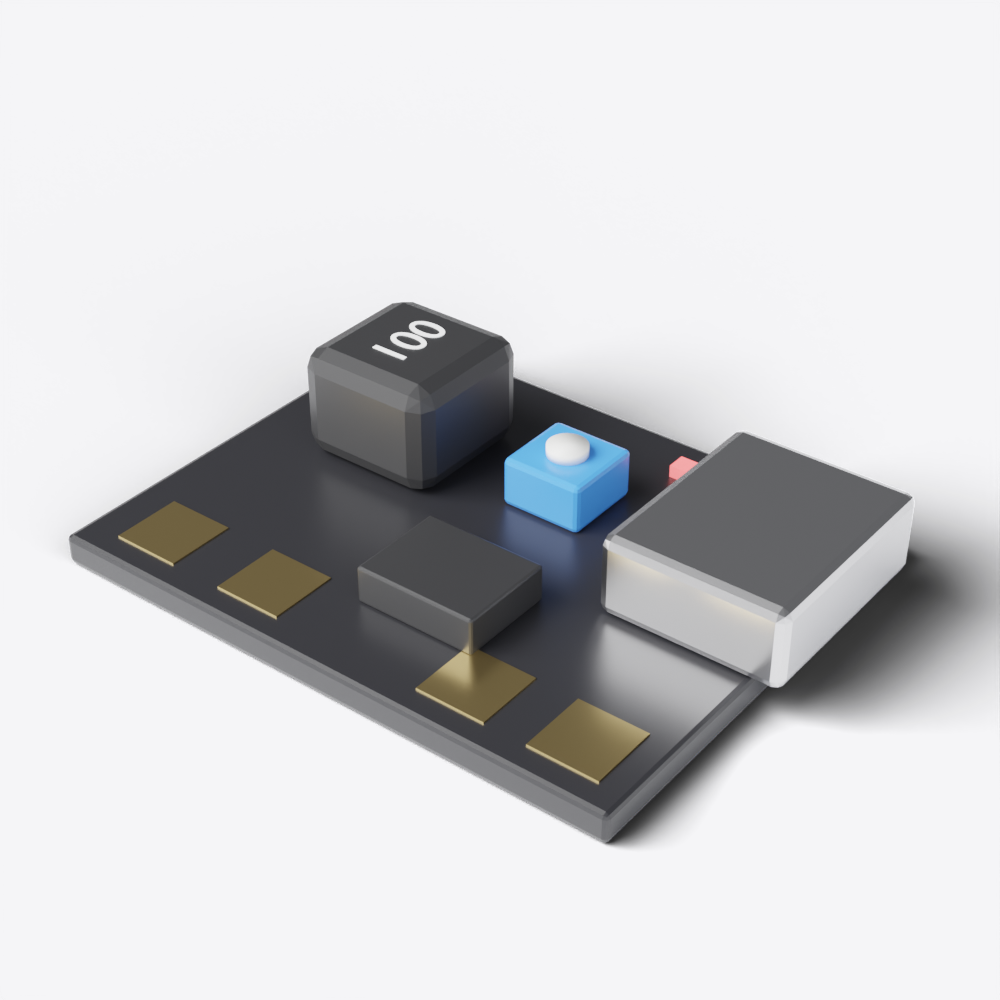 | 4 | **Charger + boost board**, "TP4056 type", 1 A charge, adjustable 4.2–28 V out, USB-C, 24 × 19 mm | 1 | Charges the LiPo and makes the 5 V rail. Set the output to **5.00 V** first | [Amazon](https://www.amazon.com/dp/B0H4FLDTQV) |
| 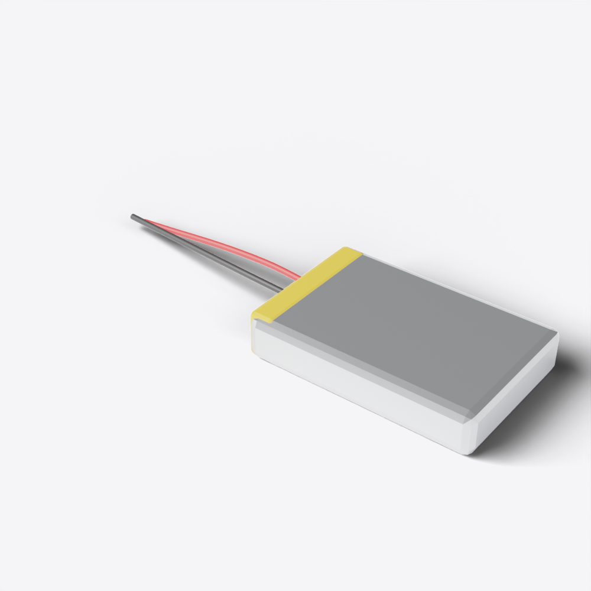 | 5 | **LiPo pouch cell 3.7 V, size 103450** (≈ 50 × 34 × 10 mm, ≈2000 mAh), with protection board and JST-PH lead | 1 | Must fit the 52 × 35 × 10 mm tray including its protection board — check the listed size. Never clamp a pouch cell | [Amazon](https://www.amazon.com/dp/B0CNLWVCK1) |
| 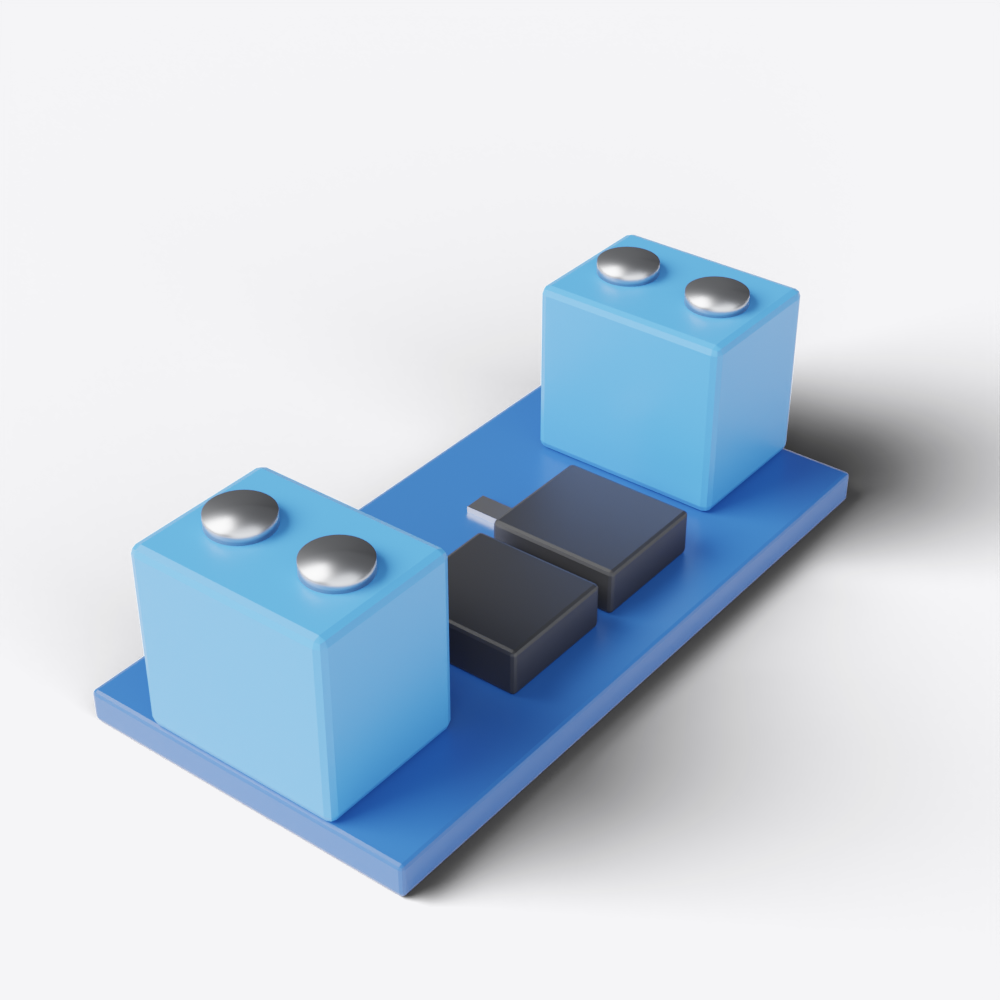 | 6 | **MOSFET trigger module** ("XY-MOS", 2 × D4184) | 1 | Switches the trackball off in sleep. A bare IRLZ44N + 220 Ω + 100 kΩ works too | [Amazon](https://www.amazon.com/dp/B0BZ57XKXZ) |
| 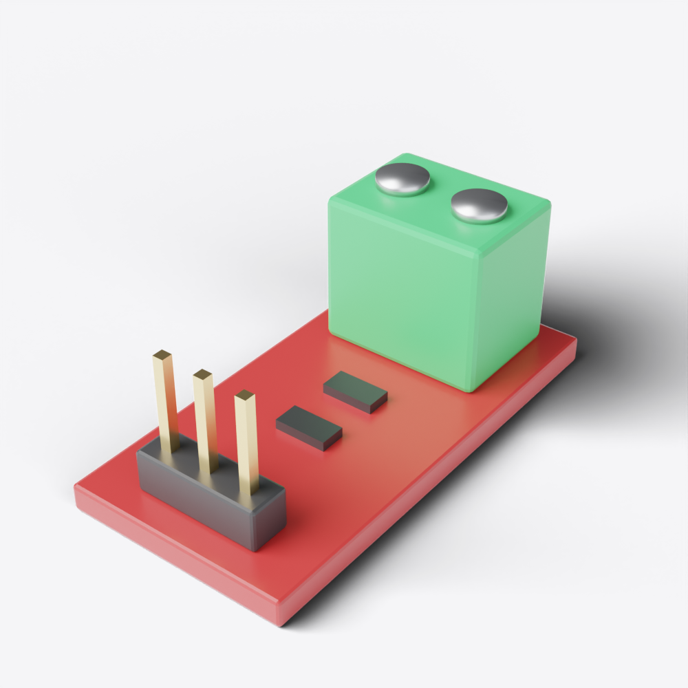 | 7 | **0–25 V voltage sensor module** (30 k / 7.5 k divider, ÷5) | 1 | Battery level | [Amazon](https://www.amazon.com/dp/B01HTC4XKY) (5-pack) |
| 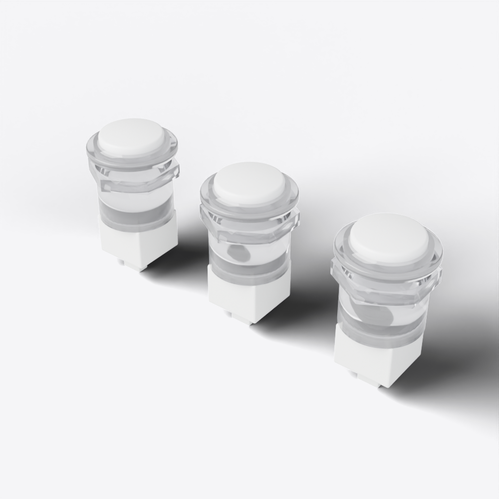 | 8 | **Lit arcade buttons**, 30 mm (1-1/8"), 5 V LED, 3-wire XH harness | 3 | LEFT / MENU / RIGHT. Below-panel depth ≤ 60 mm | [Amazon](https://www.amazon.com/dp/B07JFXQSM5) (Hikig kit these came from — includes extras) |
| 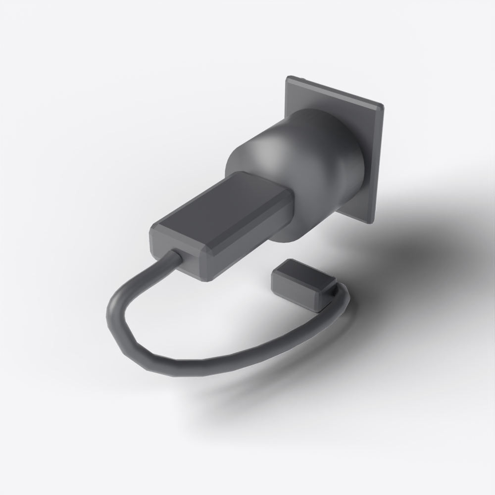 | 9 | **USB-A female/female D-type panel feedthrough** (body Ø23.7, holes 19 × 24 mm diagonal) | 1 | The one external port | [Amazon](https://www.amazon.com/dp/B0B2HVRDHL) |
| | 10 | **Short micro-USB to USB-A cable** | 1 | Inside: Pico → feedthrough | [Amazon](https://www.amazon.com/dp/B013G4EAEI) |
| | 11 | **USB-C male pigtail, 2-wire** (red / black) | 1 | Pico VBUS → charger input | [Amazon](https://www.amazon.com/dp/B0DCGJY4MR) |
| | 12 | **USB-A to USB-A cable** (plain, no chip) | 1 | Outside: controller → computer (USB 3 port recommended for charging) | [Amazon](https://www.amazon.com/dp/B00HSS9JMW) |
| | 13 | Dupont jumper wires (female), hookup wire, 3-way lever connectors, heat-shrink | — | Everything plugs or clamps | [Dupont wires](https://www.amazon.com/dp/B01EV70C78) · [WAGO 221-413](https://www.amazon.com/dp/B0719LG1TF) |

### Hardware

Screws are standard sizes; any assortment works.


| Part | Qty | Used for | Buy |
|---|---|---|---|
| M3 × L4 × D5 heat-set insert | 4 | corner pillars of the top shell | [Amazon](https://www.amazon.com/dp/B0FDKYTMZ8) |
| M3 × 8 countersunk screw | 4 | bottom plate → inserts | any |
| M3 × 8 self-tapping screw | 2 | USB-A feedthrough → rear wall | any |
| M2.5 × 8 self-tapping screw | 2 | e-paper clips | any |
| M2 × 6 self-tapping screw (optional) | 4 | Pico → standoffs (a dab of glue works too) | any |
| 3M Bumpon SJ5312 rubber feet (Ø12.7 × 3.5) | 4 | recesses in the bottom plate | [Amazon](https://www.amazon.com/dp/B000NG60SW) |
| Zip tie ≥150 mm or double-sided foam tape | 1 | battery retention | any |

### Printed parts

| Part | Plate | Print time | Filament |
|---|---|---|---|
| Top shell | 1 | ≈ 5 h 50 min | ≈ 323 g |
| 2 e-paper clips | 1 | (with the shell) | — |
| Bottom plate | 2 | ≈ 2 h 40 min | ≈ 123 g |

PLA, 0.4 mm nozzle, 0.20 mm layers — about **8.5 h and 450 g** in total.

### Tools

Soldering iron (for the heat-set inserts), multimeter, small screwdrivers,
side cutters, a computer with Python for flashing the Pico.

---

## Step 1 — Print the case

Every print file comes with its settings built in. Pick your printer's
folder in [`print/`](print/README.md) — **`bambu-x1c/`**, **`bambu-p1s/`**
or **`bambu-a1/`** — and open:

- **`gt-trackball-all.3mf`** — everything on 2 plates (≈ 8.5 h, 446 g), or
- `top.3mf`, `bottom.3mf`, `clips.3mf` — one part at a time.

**Slice all** and print. No supports; any printer with a 256 mm bed works.

Other slicers: the plain STLs are in [`print/stl/`](print/stl/), settings in
[print/README.md](print/README.md) — 4 walls, 15 % gyroid, 5/4 top/bottom
layers, 5 mm brim, no supports, parts as exported (top shell deck-down).

After printing:
- Melt the **4 M3 heat-set inserts** into the corner pillars of the top
  shell (~230 °C for PLA, iron square to the hole).
- Test-fit a button (Ø29.3 holes) and the USB feedthrough.

---

## Step 2 — Prepare the electronics

**2.1 Set the charger's output to 5.00 V.** Connect the LiPo to B+ / B−,
plug a USB-C charger into the board once (its output switches on the
first time it sees USB power), then turn the trimpot until **VO+ to VO−
reads 5.00 V** on a multimeter. Do this *before* anything else is
connected.

**2.2 Flash the Pico.** Hold BOOTSEL, plug the Pico into a computer, and
copy
[`firmware/micropython/gt-trackball-micropython-v1.29.0-RPI_PICO2_W.uf2`](firmware/micropython/)
onto the `RP2350` drive. This is MicroPython with small fixes the
controller needs (trackball start-up mode, Bluetooth pairing) — the stock
download won't work. Then install the tool and libraries and copy the
firmware:

```
pip install mpremote
mpremote mip install aioble
mpremote mip install usb-device-hid
cd firmware
mpremote cp config.py ps2.py hid_mouse.py usb_mouse.py epd213.py art.py display.py swing.py battery.py main.py :
```

**2.3 Check each button harness.** The wire markings differ between
harnesses, so go by **plug position**: hold the plug latch toward you,
wires down, pins 1-2-3 left to right. **1 = LED −**, **2 = switch**,
**3 = LED + and the switch's other side**. 5 V on pin 3 and GND on pin 1
should light the button.

---

## Step 3 — Wire it up

Wire it in four steps — each picture highlights only that step's wires.
A small bridge means two wires cross without touching; a dot means they
join. Everything plugs or clamps: Dupont jumpers on the Pico's pins, screw
terminals on the modules, a lever connector for the 5 V split.

**3.1 Power and charging**

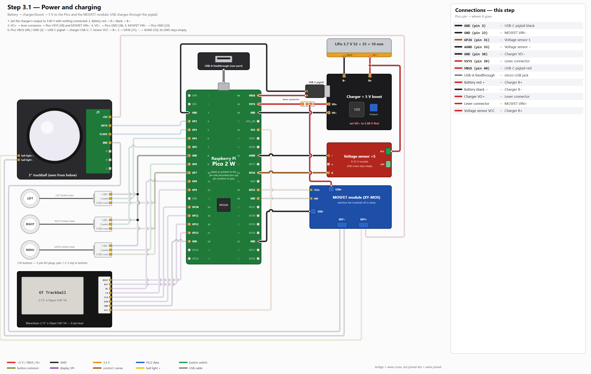

**3.2 Trackball**

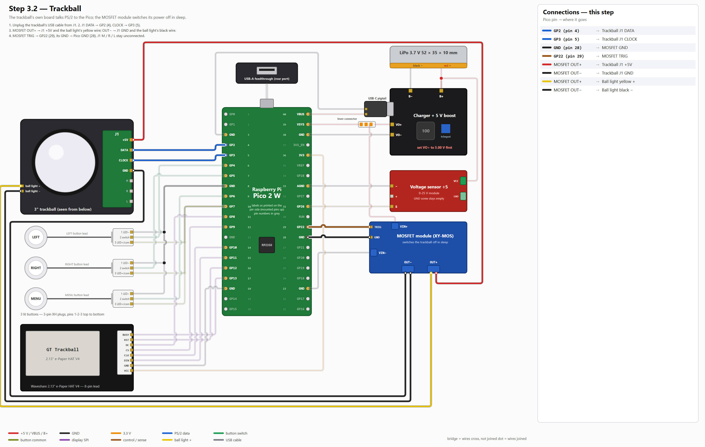

**3.3 Buttons**

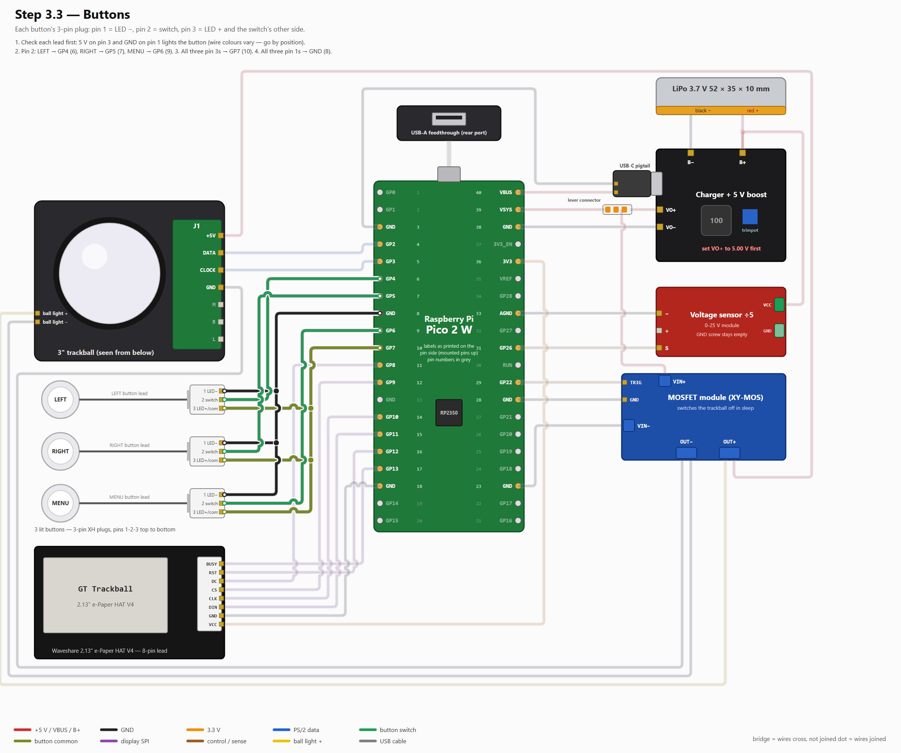

**3.4 Display**

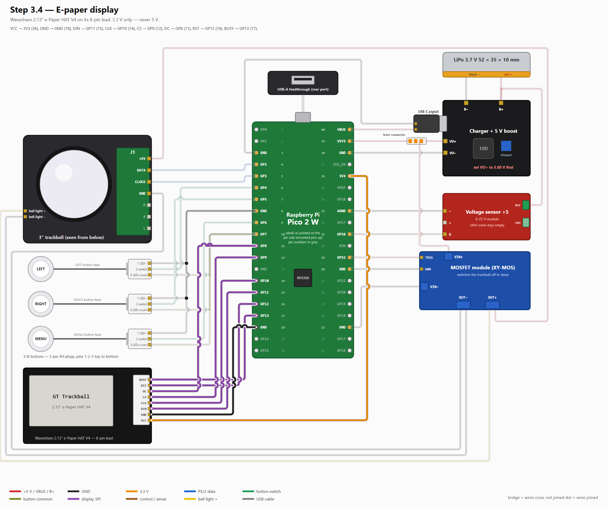

**All together** ([full-size SVG](images/wiring.svg)):

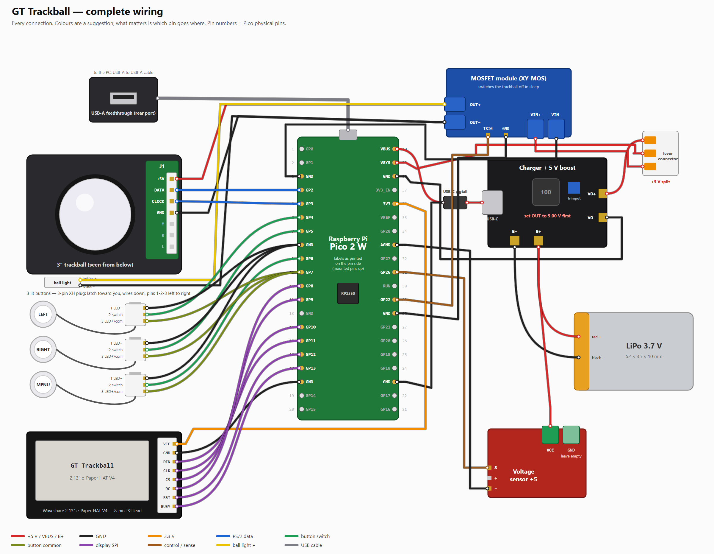

The same connections as a table:

The Pico is mounted **upside down** (pins up). Its pin labels are printed
on the pin side — wire by the labels.

| Pico pin | Goes to |
|---|---|
| GP2 (4) / GP3 (5) | trackball J1 **DATA** / **CLOCK** |
| GP4 (6) / GP5 (7) / GP6 (9) | LEFT / RIGHT / MENU button, harness **pin 2** |
| GP7 (10) | all three buttons, harness **pin 3** |
| GND (8) | all three buttons, harness **pin 1** |
| GP8–GP13 | e-paper: DC=GP8, CS=GP9, CLK=GP10, DIN=GP11, RST=GP12, BUSY=GP13 |
| 3V3 (36) / GND (18) | e-paper VCC / GND — **3.3 V only** |
| GP22 (29) / GND (28) | MOSFET module TRIG / GND |
| GP26 (31) / AGND (33) | voltage sensor S / − |
| VSYS (39) | +5 V from the charger's VO+ (a lever connector also feeds MOSFET VIN+) |
| GND (38) | charger VO− |
| VBUS (40) / GND (3) | USB-C pigtail red / black → charger's USB-C jack |
| micro-USB jack | short micro-USB-to-A cable → USB feedthrough |

Power side:
- **Charger** B+ / B− → LiPo. VO+ → Pico VSYS **and** MOSFET VIN+.
- **MOSFET module** VIN− → Pico GND (23); OUT+ → trackball J1 **+5V** and ball light
  (yellow); OUT− → J1 **GND** and ball light (black).
- **Voltage sensor** VCC screw → charger B+; S → GP26; − → AGND. Leave its
  GND screw empty (wiring it to B− would bypass the battery protection).
- Unplug the trackball's own USB cable from J1 — the Pico replaces it.

**For reference:** the same circuit as an electronics schematic
([KiCad PDF](kicad/gt-trackball.pdf), [KiCad project](kicad/)) and as a
wire-by-wire harness list with suggested colours and lengths
([WireViz drawing](harness/gt-trackball.svg), [wire BOM](harness/gt-trackball.bom.tsv)).

---

## Step 4 — Bench test

Before anything goes in the case, with the trackball and buttons on the
bench:

1. Plug the Pico into your computer. The e-paper plays a little ball-drop
   animation and shows **USB wired**; the ball moves the cursor and the
   buttons click.
2. Unplug: it restarts on battery as **pairing...** — add **GT Trackball**
   in your computer's Bluetooth settings. The screen says **BT connected**.
3. Leave it alone for 5 minutes: it shows a moon and goes to sleep. Press a
   button to wake it.

Trouble? See [Troubleshooting](#troubleshooting) and the bring-up checklist
in [firmware/README.md](firmware/README.md).

---

## Step 5 — Assemble

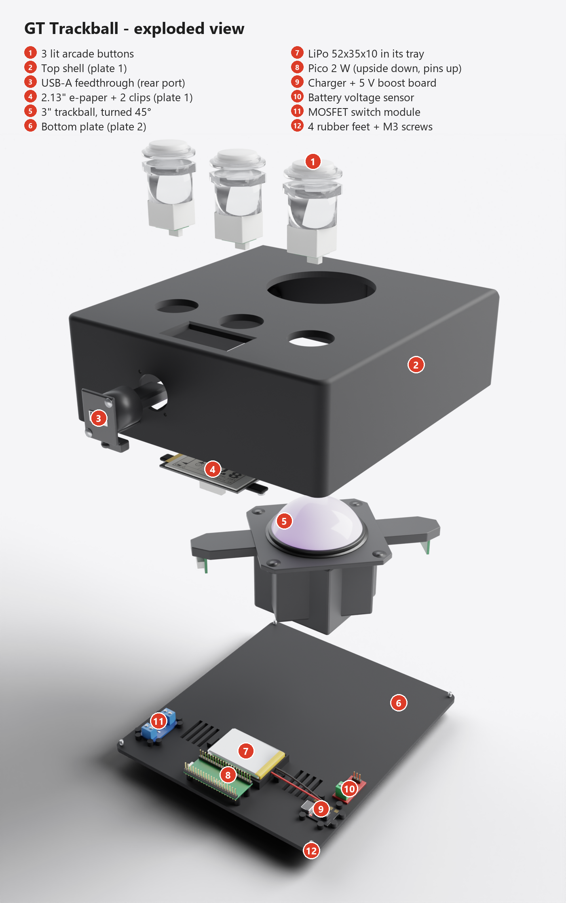

Everything in place (right half of the shell cut away):

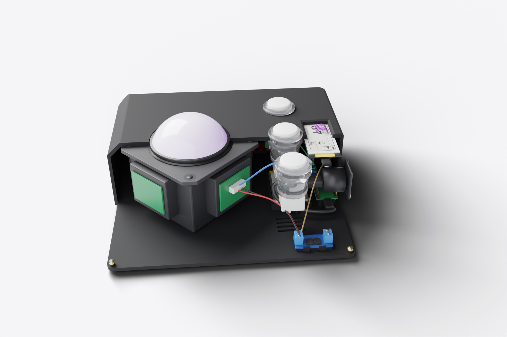

Component layout in the bottom of the case:

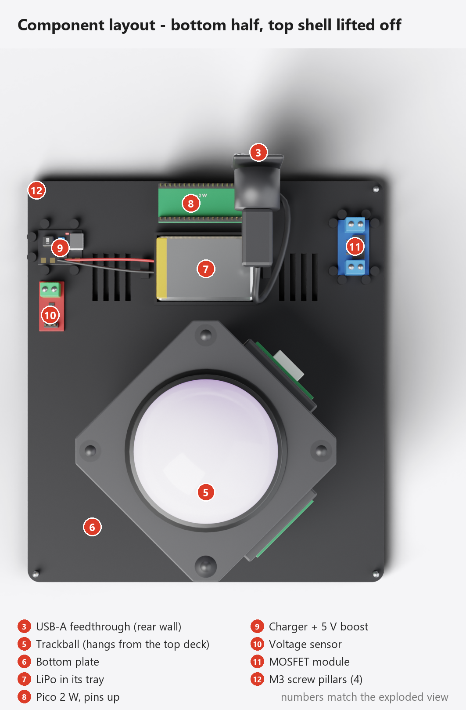

1. **Buttons (1):** push the three buttons into the top shell and tighten
   their nuts — LEFT / MENU / RIGHT, left to right seen from the front.
2. **USB feedthrough (3):** screw it into the rear wall from outside with
   two M3 self-tappers.
3. **E-paper (4):** lay it face-down into the pocket under the deck window,
   **harness side up** (toward the rear), and screw the two printed clips
   across its edges. The screen draws an outline round its edge — centre it
   in the window.
4. **Electronics on the bottom plate (6):**
   - LiPo (7) in its tray, held by foam tape or a zip tie under the two
     internal anchors
   - Pico (8) **upside down** on its four standoffs, USB jack between the
     two flattened ones
   - charger (9), MOSFET module (11) and voltage sensor (10) each **snap
     into their own cradle**: slide one edge under the two fixed lips, then
     press the other edge down until the hook clicks over it. No glue or
     screws — to remove one, push the hook outward and lift. Charger: USB-C
     end toward the battery. MOSFET: screw terminals front and back.
     Sensor: header pins toward the front (against the low stop).
   - Not sure your boards match? Print `mounts_test` first (about 25 min,
     the three cradles on their own) and try each board in it.
5. **Trackball (5):** turned 45° so its four mounting holes sit on the
   case's front/back/left/right axes; lower the top shell over it so the four pins drop into its
   holes.
6. Plug the micro-USB cable from the Pico into the feedthrough, check
   nothing is pinched, and close the case with the four M3 × 8 screws.
7. Stick the four rubber feet (12) into the recesses underneath.

---

## Step 6 — Pair and play

| | |
|---|---|
| **Bluetooth** | Unplugged = Bluetooth. Pair once as **GT Trackball**; it reconnects by itself |
| **USB** | Plug the rear port into a USB port (USB 3 recommended): it becomes a wired mouse and charges |
| **Buttons** | LEFT = left click, RIGHT = right click, MENU = middle click |
| **Sleep** | after 5 min without input; press a button to wake |
| **Screen** | connection, battery, **LAST SWING** and **BEST** after every forward swing |
| **Settings** | edit `firmware/config.py` and copy it over the USB cable — no need to open the case. Hold LEFT + RIGHT while plugging in for safe mode |

---

## Golden Tee, TeknoParrot and RetroBat

Everything that made Golden Tee Live 2018/2019 play well — turning off
Windows mouse acceleration, sensitivity per axis, the button bindings,
fixing dropped HDMI audio — plus an AutoHotkey script that lets the
trackball drive RetroBat's menus: **[pc/README.md](pc/README.md)**.

---

## Customising

- **Firmware** — `firmware/config.py`: cursor direction and speed
  (`INVERT_X/Y`, `SWAP_XY`, `SCALE_NUM/DEN`), sleep time (`IDLE_SLEEP_S`),
  swing meter (`SWING_*`), screen orientation (`EPD_FLIP`), device name.
  Details in [firmware/README.md](firmware/README.md).
- **Case** — `trackball_bt_case.scad` (OpenSCAD) is fully parametric: ball
  bore, mounting pins, button positions, display window, the board
  cradles (each board's size and thickness is a parameter: `tp_*`,
  `boost_*`, `sens_*`), feedthrough, case size. Set `part` to `top`,
  `bottom`, `mounts_test`, `clips`, `exploded` or `layout` and export. The `chk_*` parts are collision
  checks that should render empty.

---

## Troubleshooting

| Problem | Fix |
|---|---|
| Cursor moves the wrong way / axes swapped | `INVERT_X`, `INVERT_Y`, `SWAP_XY` in `config.py` |
| Trackball dead after a cold start | you're on stock MicroPython — flash the patched `.uf2` (step 2.2) |
| Bluetooth won't pair | patched `.uf2` again; then remove "GT Trackball" from the computer and pair fresh |
| Windows: connected but no cursor after a sleep | update to the latest firmware (it no longer relies on Windows re-subscribing) |
| Backswing choppy in games | turn off **Enhance pointer precision** in Windows |
| A button doesn't register | check that harness by plug position (step 2.3) |
| Screen upside down | `EPD_FLIP` in `config.py`, or turn the display round |
| Battery % wrong | measure the cell, adjust `BATT_DIVIDER` |
| Can't copy files any more | safe mode: hold LEFT + RIGHT while plugging in |

---

## Build it with Claude Code (optional)

This repository includes a [`CLAUDE.md`](CLAUDE.md) that turns
[Claude Code](https://claude.com/claude-code) into a build assistant for this
project. It knows the parts, the wiring, the safety checks and the firmware,
and it can run the flashing and configuration commands on your computer
for you (it asks before running each one).

1. Install Python 3 and `pip install mpremote` (for talking to the Pico).
2. Install Claude Code (see its website for the one-line installer) and sign in.
3. Get this project: `git clone https://github.com/growthlayer/gt-trackball`
   (or download the ZIP), then open a terminal in that folder and run `claude`.
4. Ask it things like:
   - *"Walk me through Step 3, one wire at a time."*
   - *"Here's a photo of my wiring — does it match the power step?"*
   - *"My Pico is plugged in holding BOOTSEL. Flash the firmware."*
   - *"The cursor moves the wrong way left-right. Fix it."*
   - *"Make the trackball slower in Bluetooth mode."*
   - *"Make print files for my Prusa MK4."*
   - *"It doesn't show up in Bluetooth. Help me find out why."*

It works from the same instructions as this guide. Take your time with
the multimeter checks it asks for: they protect the battery and the screen.

## Repository layout

| Folder | What's in it |
|---|---|
| [`print/`](print/README.md) | ready-to-print Bambu Studio projects for X1C / P1S / A1 (all-in-one + per part), STLs, print settings |
| `tools/` | `make_print_files.py` (every 3MF from the STLs), `make_wiring_diagrams.py` (step wiring pictures), `make_overview.py` (the "how it connects" picture), `make_kicad_schematic.py` (the KiCad schematic) |
| `kicad/` | KiCad 10 schematic project, PDF and SVG |
| `harness/` | WireViz harness source (`gt-trackball.yml`) and its drawings + wire BOM |
| [`firmware/`](firmware/README.md) | MicroPython firmware, the patched MicroPython build and its source patch |
| [`pc/`](pc/README.md) | Windows / TeknoParrot / RetroBat setup and the menu script |
| `images/` | renders, wiring and overview diagrams |
| `CLAUDE.md` | instructions that make Claude Code a build assistant for this project |
| `renders/` | Blender script that makes the product renders |
| `trackball_bt_case.scad` | the parametric case |

## Design notes

The trackball fit is copied exactly from the original case, which fits
these trackballs perfectly: a straight Ø76.1 bore through a 4.5 mm deck,
four solid Ø5.1 × 18.5 mm locating pins at r = 56.6 mm that drop into the
trackball's mounting holes (the trackball sits turned 45°), and 63.9 mm
floor-to-ceiling so the trackball is clamped between the floor and the
deck. Compared with the original: a third button, a rounded palm bevel,
a display window, mounts for every board, an internal battery tray, a
single rear port, heat-set inserts, feet recesses and vents. The case is
201 × 225 × 72 mm.

---

## Credits & licence

- **Case:** remix of
  [3-Inch Arcade Trackball Case (thing:7334881)](https://www.thingiverse.com/thing:7334881)
  by **vkschannel** (itself a remix of
  [thing:5914322](https://www.thingiverse.com/thing:5914322)), licensed
  CC BY-SA. This remix (`trackball_bt_case.scad`,
  `print/`, `images/`) is therefore also
  **[CC BY-SA 4.0](https://creativecommons.org/licenses/by-sa/4.0/)**.
- **Firmware and scripts** (`firmware/`, `pc/`, `renders/`):
  **[MIT](LICENSE-CODE)**.
- **MicroPython** and **micropython-lib** (aioble, usb-device-hid): MIT,
  © Damien P. George and contributors. The `.uf2` in `firmware/micropython/`
  is MicroPython v1.29.0 plus the included patch.
- The e-paper init sequence follows Waveshare's published 2.13" V4 demo.

See [LICENSE](LICENSE).
